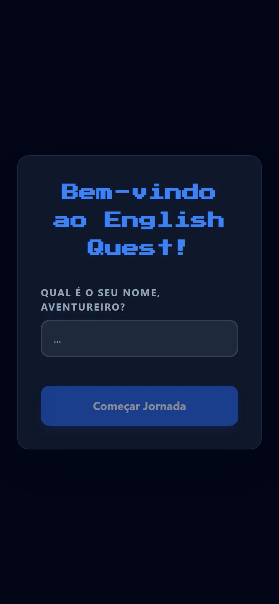
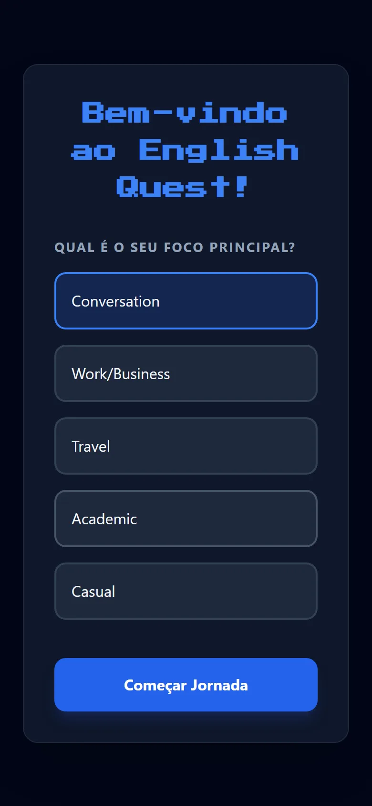
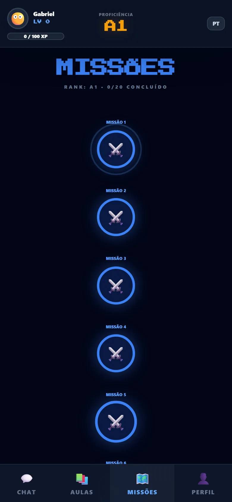
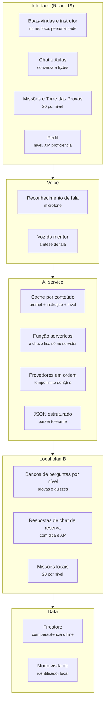

# English Quest Adventure

> An RPG-style English learning platform with chat, voice, instructors with personality and an AI that never leaves the learner without a lesson.

[Ler em português](README.md) · [See the other work in the portfolio](https://github.com/gabrieldacostarosa/portfolio)

| | |
|---|---|
| **Status** | Live |
| **My role** | Complete product design, experience writing and development, solo. |
| **Stack** | `React 19` `TypeScript` `Vite` `Gemini API` `Netlify Functions` `Firestore` `Voz` |
| **Open live** | https://englishadventurerquest.netlify.app |

## Problem

Practicing English conversation without embarrassment, with the motivation of a game, without the product depending on an AI that can fail.

## Result

Voice chat, 20 quests per level, the AI key on the server only, a 3.5 s timeout per provider and a local plan B.

## Screens

   

## Context and problem

Learning English from textbooks is dull and conversation is what really works, but not everyone has someone to practice with. I wanted a place where a person could talk, make mistakes without embarrassment and feel progress, with the mechanics of an RPG: adventurer, quests, trail and growth. The engineering challenge was to use AI to bring the product to life without the product depending on an AI that can be slow, expensive or down.

## What was built

- An in-character welcome: the adventurer gives a name, picks a focus (conversation, work and business, travel, academic or casual) and chooses an instructor from four personalities (strict, friendly mentor, British professor or American gamer).
- Four areas in the app: Chat, Lessons, Quests and Profile. Quests are 20 per proficiency level, plus the Tower of Trials, with level, XP and proficiency in the header. There is also an option to forge a lesson on any subject.
- Voice chat: speech recognition to practice speaking and a mentor voice through speech synthesis.
- An AI layer in four parts: a content-keyed response cache, a serverless function that keeps the key on the server only, a list of providers tried in order with a 3.5 s timeout, and a JSON parser tolerant of replies with surrounding text.
- A local plan B: question banks by level, fallback chat replies and local quests keep chat, quests and exams working even without AI.
- Progress saved to Firestore with offline persistence; if the database isn't configured, the app falls back to guest mode, with an identifier kept on the device itself.

## Architecture

AI is treated as a dependency that can fail: the browser never sees the key, every call has a time limit and the product always has somewhere to land.

## Decisions and trade-offs

| Decision | Why | Cost |
|---|---|---|
| The AI key stays on the server, behind a serverless function | The browser talks to a proxy on the site itself, and the proxy talks to the providers. The key never appears in the code delivered to the user, and providers can be swapped without changing the app. | One extra network hop and a dependency on the function being up; a cold start can make the first reply slower. |
| Providers tried in order, with a short 3.5-second timeout | In a conversation, waiting longer than that feels like a freeze. It's better to move to the next provider than to leave someone staring at a screen. | Some slow but good replies are discarded. |
| Response cache keyed by the request content (prompt, instruction and level) | Someone asking for the same lesson at the same level gets the answer instantly and at no AI cost, which also lowers the risk of exceeding quota. | Less variety in repeated answers and the need to decide when the cache expires. |
| A local plan B with question banks by level | If AI fails, chat answers with a fallback reply and quests and exams come from the local bank, instead of showing an error. The person doesn't lose their study rhythm. | Local content is more generic, and the banks need their own upkeep. |
| A tolerant JSON parser | Models sometimes wrap JSON in text or code markup. The parser extracts the valid part instead of breaking, and the structured response feeds the interface directly. | A tolerant parser may accept malformed answers; validating the shape with a schema is the next step. |
| A database with offline persistence and a guest mode | People start studying without creating an account, and progress survives an unstable connection. Without the database, the app keeps working. | In guest mode progress stays on that device only and can be lost. |

## Quality and security

- The AI key is not in the code delivered to the browser: I checked the published bundle and there is no key in it.
- AI failure handled on every call: with the cache and the local plan B, the person is never left without content.
- An unavailable database doesn't take the app down; it falls back to guest mode.

## What I would change

- Cover the provider chain, the cache and the local plan B with automated tests.
- Validate incoming JSON against a schema instead of accepting any object.
- Replace the runtime Tailwind CDN with CSS generated at build time, for a faster start and no external dependency.

---

**All rights reserved.** This repository holds the project's documentation. The source code is private.
