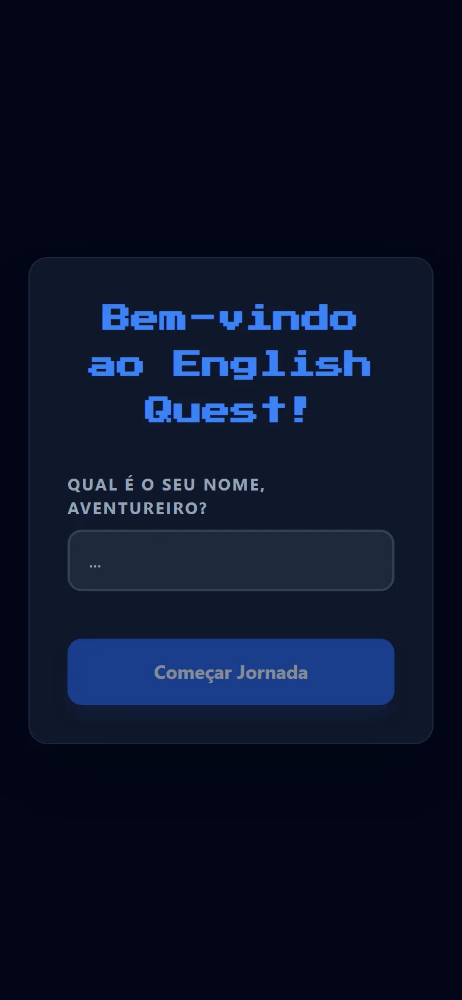
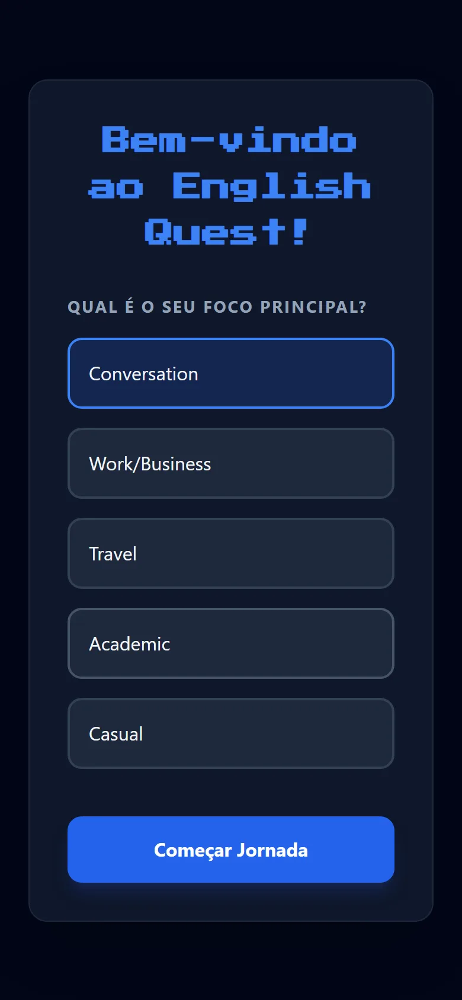
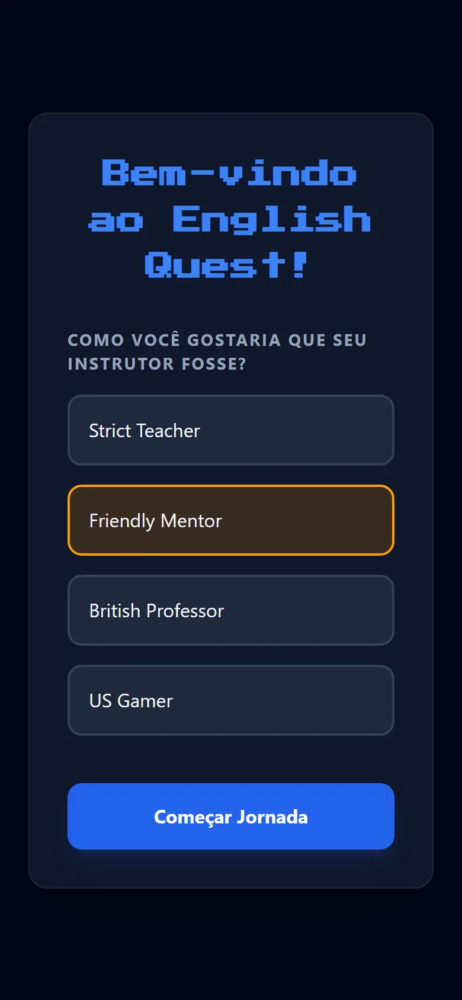
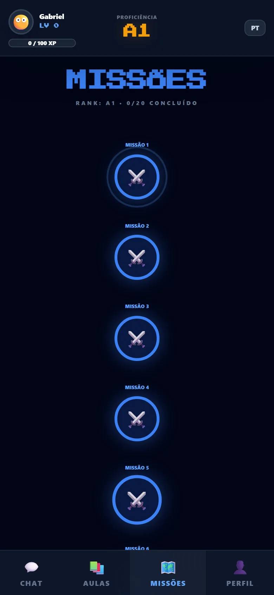
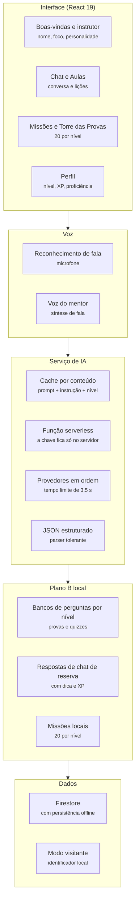

# English Quest Adventure

> Plataforma de inglês em formato de RPG, com conversa, voz, instrutores com personalidade e uma IA que nunca deixa a pessoa sem aula.

[Read in English](README.en.md) · [Veja os outros trabalhos no portfólio](https://github.com/gabrieldacostarosa/portfolio)

| | |
|---|---|
| **Situação** | No ar |
| **Meu papel** | Projeto, texto da experiência e desenvolvimento completos, sozinho. |
| **Stack** | `React 19` `TypeScript` `Vite` `Gemini API` `Netlify Functions` `Firestore` `Voz` |
| **Abrir ao vivo** | https://englishadventurerquest.netlify.app |

## Problema

Praticar conversa em inglês sem constrangimento, com a motivação de um jogo, sem que o produto dependa de uma IA que pode falhar.

## Resultado

Conversa com voz, 20 missões por nível, chave de IA só no servidor, tempo limite de 3,5 s por provedor e um plano B local.

## Telas

   

## Contexto e problema

Aprender inglês com apostilas é chato e conversar é o que realmente funciona, mas nem todo mundo tem com quem praticar. Quis um lugar onde a pessoa conversasse, errasse sem vergonha e sentisse progresso, com a mecânica de um RPG: aventureiro, missões, trilha e evolução. O desafio de engenharia era depender de IA para dar vida ao produto sem que o produto dependesse de uma IA que pode ficar lenta, cara ou fora do ar.

## O que foi construído

- Boas-vindas em personagem: o aventureiro diz o nome, escolhe o foco (conversa, trabalho e negócios, viagem, acadêmico ou casual) e escolhe o instrutor entre quatro personalidades (rigoroso, mentor amigável, professor britânico ou gamer americano).
- Quatro áreas no app: Chat, Aulas, Missões e Perfil. As Missões são 20 por nível de proficiência, mais a Torre das Provas, com nível, XP e proficiência no cabeçalho. Há também a opção de forjar uma lição sobre qualquer assunto.
- Conversa com voz: reconhecimento de fala para treinar falando e voz do mentor por síntese de fala.
- Camada de IA em quatro partes: um cache de respostas por conteúdo, uma função serverless que guarda a chave só no servidor, uma lista de provedores tentados em ordem com tempo limite de 3,5 s e um parser de JSON tolerante a respostas com texto ao redor.
- Plano B local: bancos de perguntas por nível, respostas de chat de reserva e as missões locais mantêm chat, missões e provas funcionando mesmo sem IA.
- Progresso salvo no Firestore, com persistência offline; sem o banco configurado, o app cai para o modo visitante, com identificador guardado no próprio aparelho.

## Arquitetura

A IA é tratada como uma dependência que pode falhar: o navegador nunca vê a chave, toda chamada tem tempo limite e o produto sempre tem para onde cair.

## Decisões e trade-offs

| Decisão | Por quê | Custo |
|---|---|---|
| A chave da IA fica só no servidor, atrás de uma função serverless | O navegador conversa com um proxy do próprio site, e é o proxy que fala com os provedores. Assim a chave nunca aparece no código entregue ao usuário e dá para trocar de provedor sem mudar o app. | Um salto de rede a mais e uma dependência da função estar no ar; uma partida a frio pode deixar a primeira resposta mais lenta. |
| Provedores tentados em ordem, com tempo limite curto de 3,5 segundos | Numa conversa, esperar mais que isso parece travamento. É melhor passar para o próximo provedor do que deixar a pessoa olhando a tela. | Algumas respostas lentas, porém boas, são descartadas. |
| Cache de respostas pelo conteúdo do pedido (prompt, instrução e nível) | Quem pede a mesma lição no mesmo nível recebe a resposta na hora e sem custo de IA, o que também reduz o risco de estourar cota. | Menos variedade nas respostas repetidas e a necessidade de decidir quando o cache expira. |
| Plano B local com bancos de perguntas por nível | Se a IA falhar, o chat responde com uma resposta de reserva e as missões e provas saem do banco local, em vez de mostrar um erro. A pessoa não perde o ritmo de estudo. | O conteúdo local é mais genérico, e os bancos precisam de manutenção própria. |
| Parser de JSON tolerante | Modelos às vezes cercam o JSON com texto ou marcação de código. O parser extrai o trecho válido em vez de quebrar, e a resposta estruturada alimenta direto a interface. | Um parser tolerante pode aceitar respostas mal formadas; validar o formato com um esquema é o próximo passo. |
| Banco com persistência offline e modo visitante | A pessoa começa a estudar sem criar conta, e o progresso sobrevive a uma conexão instável. Sem o banco, o app continua funcionando. | No modo visitante o progresso fica só naquele aparelho e pode se perder. |

## Qualidade e segurança

- A chave de IA não está no código entregue ao navegador: conferi o pacote publicado e não há nenhuma chave nele.
- Falha da IA tratada em todas as chamadas: com o cache e o plano B local, a pessoa nunca fica sem conteúdo.
- Banco indisponível não derruba o app; ele cai para o modo visitante.

## O que eu mudaria

- Cobrir a cadeia de provedores, o cache e o plano B local com testes automatizados.
- Validar o JSON recebido com um esquema, em vez de aceitar qualquer objeto.
- Trocar o Tailwind carregado por CDN em tempo de execução por CSS gerado no build, para uma abertura mais rápida e sem dependência externa.

---

**Todos os direitos reservados.** Este repositório contém a documentação do projeto. O código-fonte é privado.
